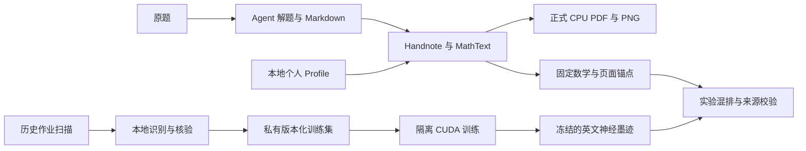

# Handwritten Solutions 项目审计记录

审计日期为 2026-11-20。范围是本仓库、配置指向的个人 Profile、本机发行包、现有训练和交付记录。审计起点为 `experiment/line-rhythm-v01023` 的 `bf32a1c`。本文续接 [2026-11-18 初始审计](docs/CURRENT_STATE_AUDIT.md)，两份记录各自保留当时的实际状态。

**正式出稿已可稳定使用，神经英文已进入四题实验混排，稳定个人风格和连续生成仍处于研发。** 当前视觉效果最有依据的改进来自较清晰的局部神经墨迹、真实样本测得的字形比例，以及受公式边界约束的词距校准。新的分层和去噪风格先验已经真实训练，仍有断笔和变形，暂不进入出稿。下一阶段优先用现有的完整词和英文行学习相邻字形与整行节奏。

## 1. 正式系统与实验版本

| 对象 | 本机核查结果 |
| --- | --- |
| 稳定源码与发行 | `main` 为 `b2754e7`。发行标签 `v0.6.0` 指向代码提交 `2bcb260`。`dist/v0.6.0/` 的 wheel、sdist、Skill ZIP、Git bundle 和 `release.json` 的 SHA-256 均通过。历史干净 wheel 检查已五题重放。 |
| 日常工作流 | Agent 按 `SKILL.md` 读取原题、推导并准备 Markdown 与清单。`font-cpu` 使用 Handnote、MathText 和 Profile 进行排版、导出 PDF/PNG、核验页数和来源。日常渲染无需 Torch 或 GPU。 |
| 默认 Profile | 本地配置和实际加载均为 `personal@v1`，75 个个人码点、178 个登记轮廓。v2 加布局，v3 另有数学横线校准。v1–v3 已发布，v4/v5 仍是本地候选。字体构建、轮廓计量和校准为 CPU 工程流程。 |
| 正式 `latest` | `v06-five-final` 仍是五题正式记录。该作业显式选择 `personal@v3`，开启 `contextual` 和语义布局，纸张为白纸，seed 73。源运行的提交 `5028b54`，renderer fingerprint `ed0e50ad74d6664a37c4f4dab36eddca177d7694c3d118a511b8dc4d54543ce2`。运行和 PDF 摘要与指针相符，像素核验通过。 |
| 研究分支 | DiffInk `21a582b`、英文评测 `24589ba`、词上下文 `f23b742` 和词距 `bf32a1c` 均保留各自分支。审计起点在 `main` 之后 200 个提交。两者的生产渲染实现和锁文件保持一致，差异集中在 Lab、研究代码与文档。 |
| 环境与归档 | 本机 CPU 环境为包 0.6.0，Handnote 2.0.0.dev0（锁定源码 `114919f…`）、Matplotlib 3.11.2、FontTools 4.68.0、PDFium Python 包 5.15.2。历史神经训练单独使用 PyTorch 2.7.1+cu128 与约 8 GB 的 RTX 5060 Laptop GPU。实验以运行目录、清单和摘要归档，现有实现采用本地 SHA-256 资产清单。 |

证据见 [稳定版验收](docs/evidence/v06-2026-11-18/README.md)、[发行清单](dist/v0.6.0/release.json)、[正式指针](workspace/latest.json)、[Profile 配置](profiles/realism-studio/settings.json)、[Workspace 契约](docs/WORKSPACE.md)。

## 2. 当前产物与质量边界

| 维度 | 已达到的结果 | 仍需验证 |
| --- | --- | --- |
| 作业内容与排版 | 固定数学基准 60 例均符合预期，54 例出页、6 例按预期拒绝。另有 8 例实际读取原题并作答的端到端演练。支持背景配置、一题一页、边界核验、个人轮廓及显式回退。 | 全套独立 Agent 解题判卷、任意 LaTeX、复杂页和跨平台出稿仍需要各自证据。四题最新实验系固定参考解答的渲染验证。 |
| 英文字形与词距 | 同文字、同墨迹权重的双种子对照中，t 实际墨迹高度 1.49→1.35，l 左空隙 0.66→0.29，r 右空隙 0.34→0.22，均以小写主体高度为单位。v0.10.23 在四页混排中把 477 对可调词缝的中位比值由 0.500 提至 0.585，词距单位为相邻词平均墨迹高，10 处极紧词缝均达到或超过 0.25。 | 字形调整有对应样本数限制。较长段落的换行、节奏和作者自然度需要单独观察。两种高度单位的数字不能直接横比。 |
| 英文内容与作者相似性 | 四页共插入 526 个神经英文词。2,985 个生成字符中，2,892 个属于有真实扫描训练覆盖的类别，93 个只用过字体辅助。早期作者认为 Handnote 单字对照更好，后来肯定局部神经生成的仿写效果，并指出断笔、字比和节奏问题。 | 逐字组合仍可出现细笔缺损和笔形歧义。最新候选尚无充分的独立人工内容准确率，也没有跨内容、跨种子稳定个人风格的作者验收。 |
| 数学结构及个人覆盖 | 四页分别涵盖谱分解、参数积分、回归、RLC。761 个数学可见项目对应区域与 Handnote 基线像素一致。逐项来源为 636 个个人轮廓、19 个拉伸个人轮廓、52 个程序化结构、22 个继承字形、32 个外部回退。历史有针对根号横线接缝及 √3 贴合的实验开关和反例。 | 数学沿用 Handnote 的结构与墨迹。还需分别检查新内容中的符号缺字、结构线条覆盖和根式专项回归。像素相同只证明该混排没有改变已排版公式。 |
| 评估与复现 | 固定英文基准 120 行，96 开发、24 留出，16 行 smoke 是开发子集。近期 24 词、8 行双种子在三个版本比较，得到 384 条 TrOCR/Tesseract 观察。v0.10.23 四张最终 PNG 和逐词落位重放一致。 | 两种识别器的差异包括标点、空格和手写误读。近期提示已多次使用，不能替代新文档留出或人工校核。 |

**可直接验收的文件**：[最新四题混排](workspace/runs/20261120T042107038172Z-measured-word-rhythm-mixed-homework-3be93094/rendered/homework_solutions.pdf) · [词距前后对照](workspace/runs/20261120T042214409111Z-rhythm-homework-replay-ff10a50d/comparisons/word-gap-before-after.pdf) · [t/l/r 逐句四列对照](workspace/runs/20261120T023635545170Z-word-context-v01022-59f5f55d/comparisons/line-layout.pdf) · [同内容 Handnote 基线](workspace/runs/20261120T042107038172Z-measured-word-rhythm-mixed-homework-3be93094/comparisons/handnote-homework.pdf)。

数学及英文来源可逐项查阅 [页面来源清单](workspace/runs/20261120T042107038172Z-measured-word-rhythm-mixed-homework-3be93094/reports/page-provenance.json)。协议和详细指标见 [数学基准](docs/BENCHMARK_V1.md)、[英文基准](docs/ENGLISH_BENCHMARK_V1.md)、[v0.10.22](docs/V01022_GO_NO_GO.md)、[v0.10.23](docs/V01023_LINE_RHYTHM.md)。

## 3. 语料和审核状态

- 早期去重后有 7 张个人采集图。v0.9 首批 7 份历史 PDF、831 页建立了目录，10 页做了首轮识别试点。页、裁剪、局部字形和同源衍生视图的数量分别统计。后续新增 A/B 采集作为训练来源，C 继续封存，用于将来候选冻结后的独立评估。[早期审计](docs/V09_AUDIT.md) · [导入与试点](docs/V09_GO_NO_GO.md) · [连续语料](docs/V0105_DATA.md)
- 意图文字、实际手写转写和参考解答分别保存。TrOCR 生成英文候选，UniMERNet tiny 生成公式候选，Tesseract 提供对照。Studio 支持原页高亮、候选、LaTeX 预览和修订历史。本人确认与获授权 Sol 核验分开标记。涂改、遮挡、邻字粘入、多个区域语义不清或标签不确定的裁剪仍应弃用；完整连笔可保留为词，不强拆。OXR、PaddleOCR 在 v0.9 属于源码和部署调查。[语料数据契约](docs/V010_DATA_FORMAT.md) · [审核与修订日志](docs/V09_DEVELOPMENT_LOG.md)
- 当前局部生成器用了 **275 个可靠字形视图、28 类真实扫描字符**，其余 44 类显式以字体辅助训练；小写 f 只有 3 个可靠孤立样本。同一词的字形和词裁剪可能来自同一段真实墨迹。历史 339 裁剪/52 类属于另一个 v0.9 数据版本。两个数量应按各自训练来源解释。[当前局部数据与训练](docs/V01021_GO_NO_GO.md) · [v0.9 扩充对照](docs/V09_EXPANDED_CORPUS_TRAINING.md)
- 现有 **39 条核验的英文行、158 个与原父裁剪像素完全一致的词和 110 对相邻词**，来自 8 份文档，可继续用于真实词和行级监督。旧开发文本及曾用于诊断的图依然属于开发证据。没有把新神经输出回标成真实个人样本。[行与词配对清单](workspace/runs/20261120T041359652980Z-verified-original-line-pair-registration-66d16c62/reports/line-registration.json)

## 4. 历史方法和取舍

| 阶段 | 实际做法 | 对当前选择的影响 |
| --- | --- | --- |
| v0.3–v0.6 CPU 真实感 | Handnote 字格提取、FontTools 合并、变体、字形度量、共享词尺度、语义公式锚点、个人结构笔画和缺字分析。旧 RL 用六类既定排版动作、代理奖励及作者偏好优化动作概率。 | 继续承担可靠内容、数学和默认出稿。字体构建、统计校准和六动作 bandit 分别记账。见 [旧审计](docs/CURRENT_STATE_AUDIT.md) 和 [M0–M5](docs/NEXT_STAGE_DEVELOPMENT.md)。 |
| v0.7–v0.8 外部模型 | 真实 CUDA 执行 DiffInk、DiffBrush、DiffusionPen 的已有权重。DiffInk 成功复现中文在线轨迹，发布字表无法覆盖任意英文。DiffBrush 的部分内容错误出现在原生输出。DiffusionPen 的少样本英文只在 smoke 实验获得有限优势。 | 保留证据和隔离环境，外部路线暂停。少样本条件推理与个人化更新分开。见 [CUDA 复现](docs/DIFFINK_CUDA_REPRODUCTION.md) 和 [英文选型](docs/V08_GO_NO_GO.md)。 |
| v0.9 个人局部墨迹 | 由数据门禁和合成夹具测试逐步进入真实监督。`reference-sdf-cvae/1` 基于 96×96 字形距离场、个人字体辅助和真实样本训练。扩充后 8,000＋8,000＋4,000 次 CUDA 更新，修复候选从各阶段最优检查点继承。 | 用户观察 Handnote 单字仍最稳。修复轮减少断裂，同时形态变化及潜变量响应收缩，更接近字体参考。支持字体锚定，现有最近邻证据不足以判定样本记忆。见 [扩充训练](docs/V09_EXPANDED_CORPUS_TRAINING.md) 和 [repair 诊断](docs/V010_GO_NO_GO.md)。 |
| v0.10–v0.10.6 区域与整词 | 真正训练过区域生成、完整词距离场、内容对齐、细笔覆盖/浓度损失和词内流场。训练图变清或重影改善时，随机完整词仍会缺笔、扭曲或失去字符身份。 | 内容明确失败时停止同配置延长。对齐、灰影和断裂分别归因，继续保留可靠整词而不强拆连笔。见 [上下文首轮](docs/V010_GO_NO_GO.md)、[去灰影实验](docs/V0102_GO_NO_GO.md)、[整词实验](docs/V0106_GO_NO_GO.md)。 |
| v0.10.7–v0.10.10 受约束词内变换 | 真实 CUDA 学习单调词内几何，再采样个人字体墨迹。v0.10.8 用冻结权重修正采样和几何以减轻断墨。复杂题加入更严格词距和连续根号横线处理。 | 这类方案能保持文本，但依赖字体轮廓，f 的变化依然有限。可保留几何和数学工程收获，主力墨迹研究转向直接生成。见 [单调对齐](docs/V0107_GO_NO_GO.md)、[采样修复](docs/V0108_GO_NO_GO.md)、[混排与几何控制](docs/V0109_GO_NO_GO.md)。 |
| v0.10.11–v0.10.14 潜空间与内容约束 | 真实训练空间编码/解码器、文本条件潜空间生成器、薄笔约束、共享作者参数、字体条件和对抗候选。重建有明显收益，随机生成出现漏字、灰芯、双边和形态收缩。 | 训练码重建与随机生成拆开验收。加步数或加强字体锚定不足以解决稳定风格。见 [潜空间实验](docs/V01011_GO_NO_GO.md)、[共享风格](docs/V01013_GO_NO_GO.md)、[内容约束诊断](docs/V01014_GO_NO_GO.md)。 |
| v0.10.15–v0.10.20 语义和原始墨迹监督 | 用字符身份和坐标替代推理阶段轮廓图，试验字体辅助内容学习、真实词位置、可靠局部形态、更宽解码器、训练与先验条件匹配、逐层调制与语义画布。清洗剔除了 8 个污染旧裁剪，保留原始字形不补笔。 | 准确条件能重建，独立采样仍出现灰墨与形变。画布与扩容收益主要体现在训练指标。见 [语义输入](docs/V01015_GO_NO_GO.md)、[原墨迹与位置](docs/V01017_GO_NO_GO.md)、[局部先验](docs/V01019_GO_NO_GO.md)、[语义画布](docs/V01020_GO_NO_GO.md)。 |
| v0.10.21 冻结规范局部生成器 | 用字符身份和数值形态条件生成规范 96×96 离线墨迹。四项真实 CUDA 总计 7,000 更新，选用小笔画加权臂，其权重谱系为 6,000 步，训练中的真实目标与字体辅助目标分开。 | 针对局部灰影和轮廓清晰度有明显收益。输出通过 Handnote 布局组合，研究基线继续用已知真实 PCA 邻域的条件抽样。见 [局部清晰基线](docs/V01021_GO_NO_GO.md)。 |
| v0.10.22–v0.10.23 上下文、先验与整页 | 对 13 个完整词训练有界空间修正，移除邻字后效果很小。两组分层风格先验、两组冻结/联合解码，以及一次 2,500 步去噪先验均真实更新，阶段合计 9,500 步。去噪从文字和噪声生成条件，部分 f 清楚，仍有 r/w/t 缺笔及一个局部 t 碰边。v0.10.23 词距为零神经更新。 | 以冻结局部生成器和有限几何调整交付最新实验页。去噪和分层路线依旧保留对照。见 [训练与消融记录](docs/V01022_GO_NO_GO.md) 和 [词距留出](docs/V01023_LINE_RHYTHM.md)。 |

各阶段步数是对应实验的实际更新。并行候选、断点恢复和最优权重祖先分别有记录。OCR 推理、PCA、版面拟合、冻结骨干重放和新一轮参数训练使用不同的账目。

## 5. 当前主力路径和未决问题

**生产采用 Handnote。研究采用清晰的冻结局部神经墨迹加确定性的数学结构。** 主模型输出像素由学习过的网络计算。实验当前仍对已见真实样本的数值形态条件取样，因此作者风格来自学习权重与已见条件两部分。四页混排里，英文以事先审过的模型生成的字形组成词，数学按 Handnote 原结构渲染。缺字、风险位置与来源标签保留在逐词和逐数学项目清单中。

当前主要风险来自训练时看到的形态与随机生成时使用的形态不一致，以及真实同类、同词和整行覆盖有限。独立形态采样也可能把词尾写法放到不合适的词中位置。去掉 PCA 零轴越界和增加解码训练都未单独解决这一点。支持个人风格的证据需要同时涵盖清晰度、同类合理变化、相邻字形适配、行内节奏及作者相似性。单一 Dice、像素不完全重复或 OCR 分数无法覆盖这些维度。

按文档留出测试的词距回归平均误差 **0.251→0.271**，复杂规则未获支持；当前采用真实下四分位参考的小幅调整。正式 Profile 继续为 v1，混排为 `held` 实验；数学神经替换、整句端到端生成、SFT 扩张和偏好优化/RL 仍须通过各自准入。

## 6. 未来规划与验收门槛

1. **先扩展可用监督。** 从已核验行和对应词裁剪建立完整词、连字片段、相邻词及整行监督，估计字符或词位置时保留可信等级。优先补 f、i、t 等断笔高发或低覆盖类及自然连笔，保留不宜切开的区域。新增的数据版本按原始文档或采集会话分组，检查近重复和源裁剪重叠。
2. **做一次有真实连续墨迹监督的有限对照。** 保留当前解码器、文字和页面布局作为对照。选择受约束的词内形态或整词墨迹模块，将已核验连续图直接用于损失。比较有无邻字条件、有无共享词变化；全组保存种子、原图、权重、优化器和曲线。优先验证笔画完整性、文字身份和连贯性，随后比较对不同词的个人风格一致性。仍有明显断笔或内容回退时先定位失败再换方法。
3. **独立内容与风格验收。** 冻结候选和测试协议后使用未用于开发的文档。保持 C 的封存纪律，已曝光的旧词句只用于回归。双识别器提出疑点，人工复核区分真正遗漏、替换、重复、截断与识别误差。用同文字、同背景及盲化的 Handnote、冻结神经墨迹、新模型对照做作者相似度和自然度判断。最近邻与重复检测作为辅助证据。
4. **数学分开准入。** 用逐项来源报告优先排查常见外部回退符号和个人结构笔画缺口。保留分数、根号、上下标、向量和矩阵的结构约束。新增符号候选通过身份、尺度、接缝、边界和复杂公式回归后再接入实验混排；独立符号表现无法替代完整公式测试。
5. **发布与后置研究。** 保持正式路径和实验后端可切换、可回退。候选发布前重放固定题库、通过内容与视觉验收、明确资产许可和版本。只有稳定的生成器、可靠的内容约束和足够的真实偏好数据都具备后，再判断 SFT 扩张、Best-of-N 或偏好优化的收益。

现有材料足以继续前两项，无需作者逐轮确认。需要作者介入的决策点是新候选通过内容筛选后的个人风格盲评、独立文档不足时的补样，以及实际切换正式 Profile 前的确认。

## 7. 本次复核范围和工程欠账

本次核对 Git 分支和发布标签、校验发行文件、实际解析默认 Profile、核验正式 `latest` 及五页 PDF、复查当前四页 PDF 和重放封存清单。v0.10.22 的 19 个子运行及 259 个保护摘要逐项通过。统计了 680 个运行目录的 manifest，其中 379 `held`、180 `passed`、72 `prepared`、49 `failed`，没有 `running` 或缺失运行清单。运行状态统计与全量文件完整性审计分别记录。上述旧测试资料显示 v0.10.23 CPU 回归 **320 项通过**，v0.10.22 的 **54 项隔离 Torch 检查**有日志；本次审计未重新训练或重跑全部测试。证据见 [v0.10.22 测试回执](workspace/runs/20261120T023635545170Z-word-context-v01022-59f5f55d/reports/tests.json) 与 [v0.10.23 重放回执](workspace/runs/20261120T042214409111Z-rhythm-homework-replay-ff10a50d/run.json)。

旧审计 A1/A2/A7 已有源码与发行摘要、可关闭的对照开关和明确的默认/实验记录。仍建议集中维护一个版本入口，减少从旧文档误取最新产物；将重要临时复现脚本和测试回执收进长期可定位的运行证据，并定期从受控私有备份做恢复抽查。旧 A3 的短公式迁移反例已有角色与锚点方案和回归，但自然布局的跨文档泛化仍欠验证。源码库当前排除原始私有材料、权重和活动运行目录。审计过程未渲染或查看封存 C 的内容。
