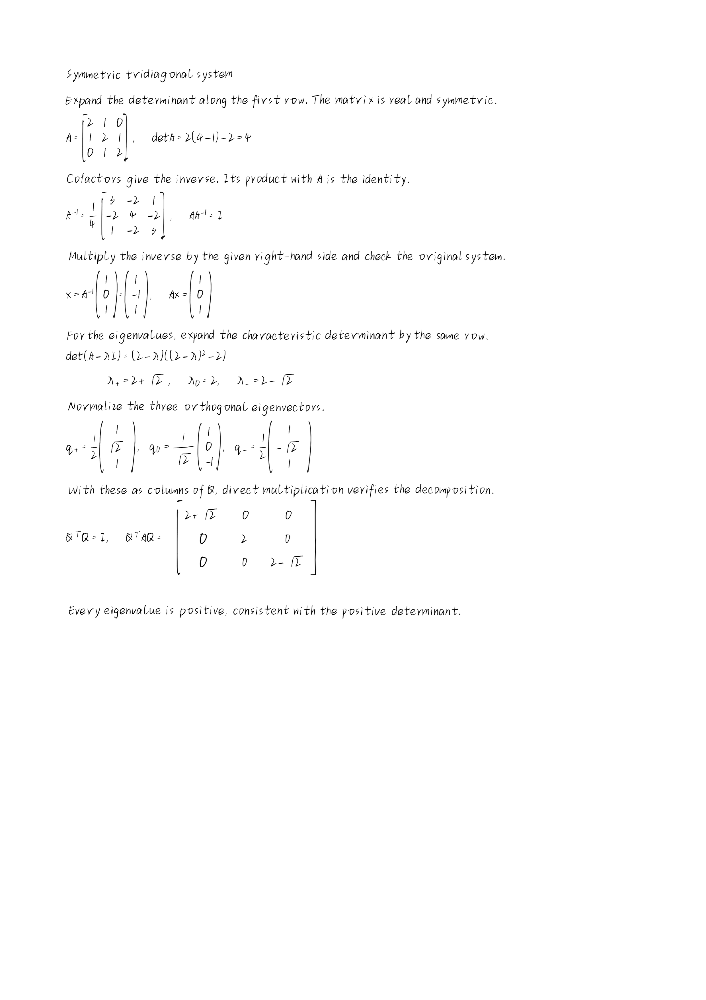
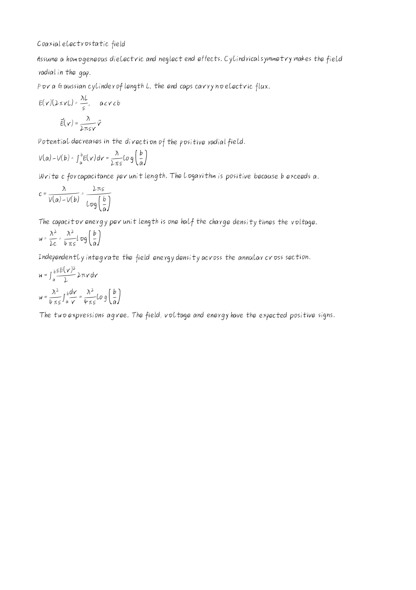
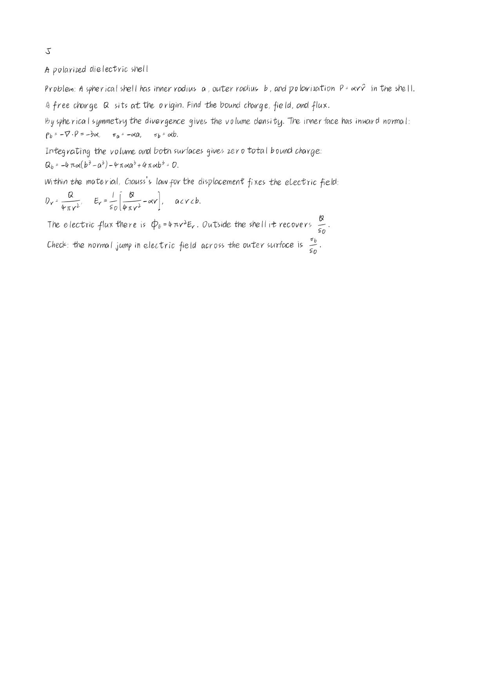

# Handwritten Solutions

**把经过核验的解答，变成可追溯的手写风格作业 PDF。**

A local Agent Skill and CPU renderer for checked mathematics homework.
One top-level problem per page, with PDF, PNG, editable solutions and provenance.

Handwritten Solutions 将宿主 Agent 的读题、解题能力与可靠的数学排版结合起来：
Agent 读取文字、图片或 PDF，编写并校核英文 Markdown / LaTeX；本地运行时负责
数学结构、手写字形、页面布局和输出检查。你也可以直接提供已经完成的解答。

v1.2.4 的默认后端是 **个人 CPU 排版 + 冻结的下一代字形模型**：数学结构、字位、
换行和页面边界由 CPU 排版决定，模型只在已有字形槽位内改变英文与数学字形。
安装完成后不需要 GPU、PyTorch 或联网下载模型。整页自由生成、连续连笔和偏好
优化仍不在本版本范围内。

## 看一下真实个人笔迹输出

下面展示的是**作者自己的笔迹 Profile** 生成的完整作业。英文与数学使用真实个人字形，
公式结构由 Handnote / MathText 排版，必要的结构笔画按已核验规则绘制；这是实际普通
CPU 出稿成品，不是神经网络生成的宣传图。作者已授权公开这些演示页面，图片和 PDF
保持验收输出原样。

| 线性代数：矩阵、方程组与谱分解 | 电磁学：同轴电容器与场能 |
| --- | --- |
|  |  |

[下载完整四页个人笔迹 PDF](public_docs/personal-demo/homework_solutions.pdf) ·
[演示说明](public_docs/personal-demo/README.md) ·
[来源汇总与校验](public_docs/personal-demo/provenance.json)

四页包含线性代数、积分、统计和电磁学，共 827 个数学可见项目，无外部字体回退；
个人结构规则和程序结构笔画仍单独记录。这四页保留为 **v1.1.0 CPU 验收输出**，
用于区分稳定 CPU 路径与新的默认后端。

### 下一代默认后端

作者已验收的七道复杂题由冻结的 `nextgen-v1` 权重生成，同一组权重现在进入
v1.2.4 的默认后端：

[七道复杂题 A](public_docs/nextgen-demo/complex-A.pdf) ·
[七道复杂题 B](public_docs/nextgen-demo/complex-B.pdf) ·
[演示说明与来源](public_docs/nextgen-demo/README.md)



页面中的英文与数学墨迹来自作者个人实写底字、有界形变和确定性墨量校正；
分数线、根号横线等结构仍由 CPU 排版绘制。v1.2.4 起，所有数学字形强制来自
个人手写来源：外来数学基字会替换为 O 原子，形变守卫失败时也回退到已适配的
O 原子，不会再把 STIX/继承字体留在页面上。发行包只包含推理所需的最小底字与
权重数组，原始扫描、完整训练语料、优化器状态和其它版本权重不分发。
详见[下一代默认生成后端](public_docs/NEURAL_MODEL.md)。

## 已有功能

- **完整作业输出**：每道顶层大题一页，小题留在所属页面；默认 A4 白纸，支持横线、方格、点阵及本地图片/PDF 背景。
- **数学结构排版**：分数、根号、求和、积分、上下标和支持范围内的矩阵；保留原始 LaTeX 与结构记录，不交给自由图像生成器猜测。
- **英文与数学混排**：英文说明、连续计算和公式统一排版，支持最高 300 DPI 的逐页 PNG。
- **核验与来源**：保存原题引用、解答 Markdown、解析后的 Job、字形来源、边界检查和输出文件摘要；错误、回退与不支持的结构明确报告。
- **下一代默认后端**：作者个人 Profile 的白纸 Job 默认启用冻结的英文/数学字形变化；不需要 Torch，失败时按字位回退到稳定 CPU 字形。
- **个人 Profile**：版本化导入、导出、比较、选择和回滚；个人墨迹候选需要独立本地资格审核，导入不会自动改变默认版本。
- **Agent Skill 与 CLI**：既可交给支持本地 Skill 的 Agent 调用，也可用命令行处理已核验的解答。

v1.2.4 的实际安装、默认后端出稿、回退和像素核验范围为
**Linux x86_64 与 macOS Apple Silicon（arm64），Python 3.12 / 3.13**。
Windows 不在本版验证范围。不同系统的文字排版库可能产生细微落点差异，
不保证跨系统像素一致。

## 可选的 Patrick Hand 兼容示例

公开安装包也保留采用 OFL-1.1 许可的 **Patrick Hand**，显式选择
`bundled-default@v1` 即可使用。下列兼容示例继续固定使用它，便于复现旧结果：

[默认字体两页 PDF](public_docs/demo/homework_solutions.pdf) ·
[默认字体预览与来源](public_docs/demo/README.md) ·
[原题](examples/release-demo/questions.md) ·
[解答一](examples/release-demo/matrix.md) ·
[解答二](examples/release-demo/integral.md) ·
[可复现 Job](examples/release-demo/job.json)

这个默认示例的根号和导数撇号使用已记录的 STIX 字体回退，
详见[字形来源](public_docs/demo/provenance.json)。

## 第一次使用

准备 **Python 3.12 或 3.13、Git 和 uv**。从本仓库的 Releases 下载并解压源码包，
在解压后的项目目录执行：

```sh
uv sync --locked --no-dev
uv run --frozen hwsol doctor
uv run --frozen hwsol render --manifest examples/release-demo/nextgen-job.json --workspace workspace
uv run --frozen hwsol workspace latest
```

`nextgen-job.json` 不固定 Profile，也不写 `backend`，因此使用已选择的默认：
干净安装即为作者个人笔迹，并使用 v1.2.4 的下一代默认后端。无需导入私人 ZIP
或运行资格审核。第一次安装需要下载锁定的依赖。此后依赖已经缓存时，可以给
`uv` 加上 `--offline`。

神经后端的推理在 CPU 上运行，每个白纸页面通常需要约半分钟到一分钟，而不是纯 CPU 路径的几秒。
横线、方格、点阵和图片/PDF 背景当前委托稳定 CPU 路径；作者预设的最终词距要求
语义排版，因此这些背景在有该设置的 Profile 上会被明确拒绝，而不是静默出稿。
需要完全确定性或更快出稿时，在 Job 中显式写 `"backend": "font-cpu"`。
命令会打印实际运行目录；使用它核验成品：

```sh
uv run --frozen hwsol verify --job workspace/runs/<run_id> --pixels
```

在该运行目录中，你会得到：

```text
rendered/
  homework_solutions.pdf
  pages/01.png, 02.png, ...
  solutions/01.md, 02.md, ...
  manifest.json
  validation_report.json
run.json
```

`<run_id>` 需要替换成命令实际返回的值。运行记录与已有产物不会被新任务覆盖。

如果只需要安装 CLI，也可以在 Python 3.12/3.13 虚拟环境中安装 Releases 的 wheel：

```sh
python3.12 -m venv .venv
.venv/bin/python -m pip install /path/to/handwritten_solutions-1.2.4-py3-none-any.whl
.venv/bin/hwsol doctor
```

wheel 提供命令行程序；演示输入、完整文档与 Skill 文件请使用源码包或 Skill 包。
不要将尚未发布到 PyPI 的版本当作可直接 `pip install handwritten-solutions` 获取的包。

## 交给 Agent 使用

下载 Skill 包，将其中的 `handwritten-solutions` 目录放进你的 Agent 的 Skill 目录，
按 [SKILL.md](SKILL.md) 完成运行环境配置。可以这样提出任务：

> 读取这份数学作业，保留题号和小题结构，给出必要的英文解题步骤并独立核验。
> 然后使用 Handwritten Solutions 生成 A4 白纸 PDF 和逐页 PNG，每道大题一页，
> 同时保留可编辑解答与核验报告。

读题和数学推理由宿主 Agent 完成；CLI 不是内置通用解题模型。`verify` 检查文件、
页面、来源和渲染一致性，不能代替数学推理的独立核验。

自行创建新作业时，将原题、`answer.md` 和 `job.json` 放在同一输入目录，参考
[完整使用指南](public_docs/GUIDE.md)与[Job 格式](references/jobs.md)。

## 使用自己的笔迹

不采集也能直接使用作者随包提供的个人风格。建立自己的 Profile 只需：

```sh
hwsol profile template --output out/my-handwriting.pdf --sets 2
# 填写、扫描，并核对实际笔迹与标签后：
hwsol profile build --profile my-handwriting --template out/my-handwriting.json \
  --source /path/to/filled-scans.pdf --labels-reviewed
# 打开返回的 PDF/PNG 预览，确认后启用返回的实际版本：
hwsol profile publish --profile my-handwriting --version v1 --activate
```

[三步详细教程](public_docs/PROFILES.md#从零建立自己的-profile三步)说明采集格式、预览、
补样和回滚。这里是 CPU 字形提取与几何校准，没有神经网络参数训练。
`publish` 只写本机资料库，不上传网络。新的基础字体 Profile 无需跨机器资格证据包。

本版本的下一代字形后端只对随包发行、已有包内审核的作者 Profile 启用；
用户自建 Profile 和 Patrick Hand 继续使用稳定 CPU 路径。

复杂的自定义数学墨迹配方仍使用独立的候选审核流程；详见
[个人 CPU Profile 流程](public_docs/GUIDE.md#use-a-reviewed-personal-cpu-profile)。
发行内置的作者 Profile 已有包内审核记录，普通用户无需重复走这个维护流程。

## 当前边界与后续方向

不是任意 LaTeX 都受支持。完整 TeX 宏包、特别复杂或过密的结构可能被明确拒绝；
缺少可用字形时会记录回退。有限作业上的零回退不等于所有数学符号全面覆盖。
发生拒绝时，应保留失败输入、检查原因并核验等价写法，不应删除必要步骤来换取通过。

下一代模型覆盖 52 个英文大小写字母和 252 个数学「符号及用途」条件。数学字形
现在强制来自个人来源；正文中 `%` 等有 O 样本的符号也会替换，没有个人样本的
正文标点（如 `;`）会保留 Profile 字形并记录在 `text_foreign_sources`，不会
被静默声称为个人笔迹。模型不会生成新的公式结构，也不保证连续
连笔。非白纸背景目前不做神经替换。

下一阶段依次改进：根据内容灵活安排英文与公式、提供直观的背景选择、尝试把答案
写入原题 PDF 的空白区域，以及把神经后端扩展到用户自建 Profile。现有背景支持
不等于已经具备空白区识别和避让题目能力。验收要求与研究边界见
[产品路线图](public_docs/ROADMAP.md)。

- [使用指南](public_docs/GUIDE.md) · [Profile 与 Studio](public_docs/PROFILES.md)
- [渲染与回退](public_docs/RENDERING.md) · [工作区与运行记录](public_docs/WORKSPACE.md)
- [研究与 Benchmark 边界](public_docs/RESEARCH_BOUNDARIES.md)
- [许可与第三方资产](public_docs/LICENSES.md) · [参与开发](CONTRIBUTING.md)

项目的原始研发提交已保留在 Git 历史中，原始 commit ID、作者与时间不变；也可查看
[原始开发分支](https://github.com/klmn-opp/handwritten_solutions_skills/tree/history/development)。
历史研究尝试与当前正式 CPU 功能应分别理解，旧版本记录不等于已通过生产验收。
