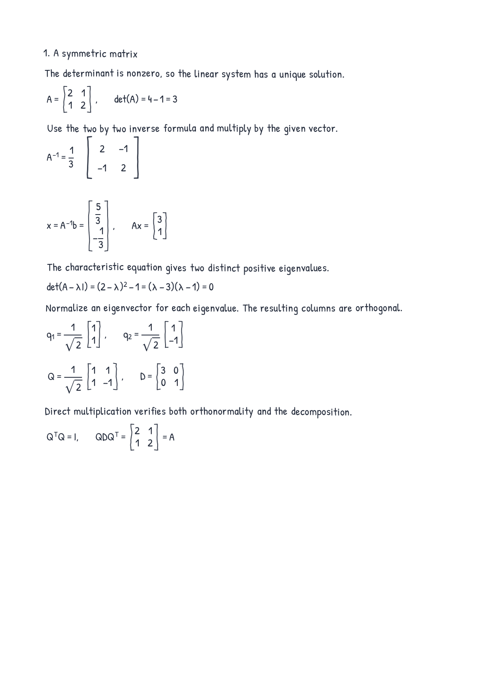
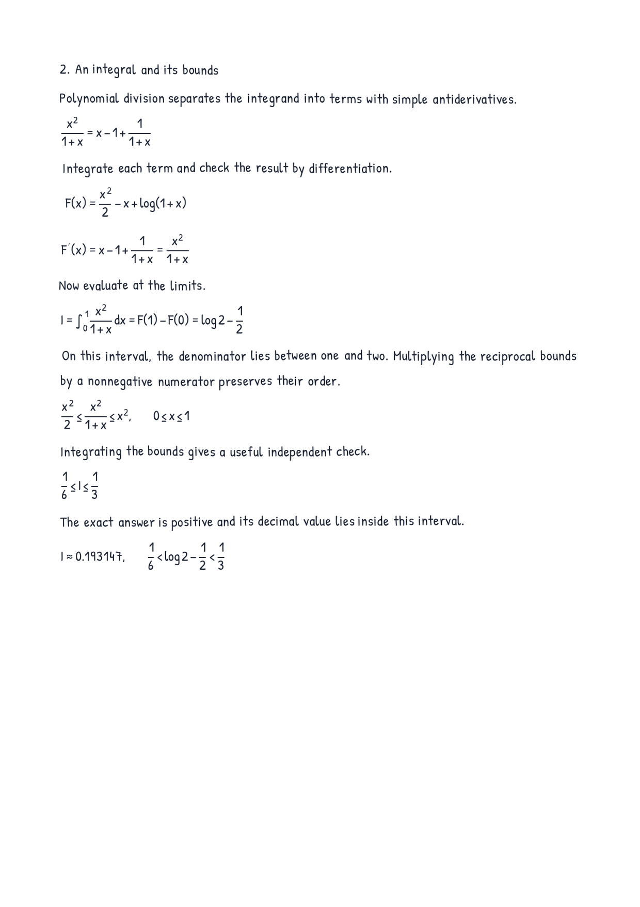

# Handwritten Solutions

**把经过核验的解答，变成可追溯的手写风格作业 PDF。**

A local Agent Skill and CPU renderer for checked mathematics homework.
One top-level problem per page, with PDF, PNG, editable solutions and provenance.

Handwritten Solutions 将宿主 Agent 的读题、解题能力与可靠的数学排版结合起来：
Agent 读取文字、图片或 PDF，编写并校核英文 Markdown / LaTeX；本地运行时负责
数学结构、手写字形、页面布局和输出检查。你也可以直接提供已经完成的解答。

v1.0 的产品核心是 **CPU 字体与结构渲染**。安装完成后，正常出稿不需要 GPU、
PyTorch 或下载生成模型。连续神经笔迹、个人风格学习与偏好优化仍是后续研究方向，
不会被当作本版本已经具备的生成能力。

## 看一下实际输出

下面的两页由项目的普通 CPU 入口实际生成，使用随包提供、采用 OFL-1.1 许可的
**Patrick Hand 默认字体**。它们展示开箱即用的效果，不是作者的私有笔迹，也不是
神经生成或图片模型制作的效果图。根号和导数撇号使用已记录的 STIX 字体回退，
详见[这份演示的字形来源](public_docs/demo/provenance.json)。

| 线性代数：矩阵与谱分解 | 微积分：积分与上下界 |
| --- | --- |
|  |  |

[下载完整两页 PDF](public_docs/demo/homework_solutions.pdf) ·
[查看原题](examples/release-demo/questions.md) ·
[解答一](examples/release-demo/matrix.md) ·
[解答二](examples/release-demo/integral.md) ·
[可复现 Job](examples/release-demo/job.json)

## 已有功能

- **完整作业输出**：每道顶层大题一页，小题留在所属页面；默认 A4 白纸，支持横线、方格、点阵及本地图片/PDF 背景。
- **数学结构排版**：分数、根号、求和、积分、上下标和支持范围内的矩阵；保留原始 LaTeX 与结构记录，不交给自由图像生成器猜测。
- **英文与数学混排**：英文说明、连续计算和公式统一排版，支持最高 300 DPI 的逐页 PNG。
- **核验与来源**：保存原题引用、解答 Markdown、解析后的 Job、字形来源、边界检查和输出文件摘要；错误、回退与不支持的结构明确报告。
- **个人 Profile**：版本化导入、导出、比较、选择和回滚；个人墨迹候选需要独立本地资格审核，导入不会自动改变默认版本。
- **Agent Skill 与 CLI**：既可交给支持本地 Skill 的 Agent 调用，也可用命令行处理已核验的解答。

发行候选已在 **Linux x86_64、macOS Apple Silicon，Python 3.12 / 3.13** 上完成真实安装、
PDF/PNG、Profile 迁移和回滚验证。不同系统的文字排版库可能产生细微落点差异，
不保证跨系统像素一致。Windows 尚不属于本版已验证的支持范围。

## 第一次使用

准备 **Python 3.12 或 3.13、Git 和 uv**。从本仓库的 Releases 下载并解压源码包，
在解压后的项目目录执行：

```sh
uv sync --locked --no-dev
uv run --frozen hwsol doctor
uv run --frozen hwsol render --manifest examples/release-demo/job.json --workspace workspace
uv run --frozen hwsol workspace latest
```

第一次安装需要下载锁定的依赖。此后依赖已经缓存时，可以给 `uv` 加上 `--offline`。
命令会打印实际运行目录；使用它核验成品：

```sh
uv run --frozen hwsol verify --job workspace/runs/<run_id> --pixels
```

在该运行目录中，你会得到：

```text
rendered/
  homework_solutions.pdf
  pages/01.png, 02.png, ...
  solutions/01.md, 02.md, ...
  manifest.json
  validation_report.json
run.json
```

`<run_id>` 需要替换成命令实际返回的值。运行记录与已有产物不会被新任务覆盖。

如果只需要安装 CLI，也可以在 Python 3.12/3.13 虚拟环境中安装 Releases 的 wheel：

```sh
python3.12 -m venv .venv
.venv/bin/python -m pip install /path/to/handwritten_solutions-1.0.0-py3-none-any.whl
.venv/bin/hwsol doctor
```

wheel 提供命令行程序；演示输入、完整文档与 Skill 文件请使用源码包或 Skill 包。
不要将尚未发布到 PyPI 的版本当作可直接 `pip install handwritten-solutions` 获取的包。

## 交给 Agent 使用

下载 Skill 包，将其中的 `handwritten-solutions` 目录放进你的 Agent 的 Skill 目录，
按 [SKILL.md](SKILL.md) 完成运行环境配置。可以这样提出任务：

> 读取这份数学作业，保留题号和小题结构，给出必要的英文解题步骤并独立核验。
> 然后使用 Handwritten Solutions 生成 A4 白纸 PDF 和逐页 PNG，每道大题一页，
> 同时保留可编辑解答与核验报告。

读题和数学推理由宿主 Agent 完成；CLI 不是内置通用解题模型。`verify` 检查文件、
页面、来源和渲染一致性，不能代替数学推理的独立核验。

自行创建新作业时，将原题、`answer.md` 和 `job.json` 放在同一输入目录，参考
[完整使用指南](public_docs/GUIDE.md)与[Job 格式](references/jobs.md)。

## 使用自己的笔迹

默认字体可以直接使用，无需采集或训练。需要个人化时，可通过本地 Studio 整理
真实笔迹、核对标签并建立版本化 Profile；这类字形提取与几何校准不是神经网络训练。

已审核的个人墨迹包采用独立流程：

```text
导入候选 → 完整页面与来源审核 → qualify-ink → publish-ink → 按需 activate
```

这里的 `publish-ink` 是向**本机资料库**发布版本，不会上传网络，也不自动设为默认。
资格与实际包、Profile 和文字排版能力绑定；导出再导入不会携带发布权限。
详见[个人 CPU Profile 流程](public_docs/GUIDE.md#use-a-reviewed-personal-cpu-profile)。

公开发行包含源码、运行时、Skill、示例和有分发许可的默认字体；不包含个人原始作业、
扫描裁剪、私有 Profile、研究权重或本地操作记录。自己的笔迹与历史数据应保存在私有资料库。

## 当前边界与后续方向

不是任意 LaTeX 都受支持。完整 TeX 宏包、特别复杂或过密的结构可能被明确拒绝；
缺少可用字形时会记录回退。有限作业上的零回退不等于所有数学符号全面覆盖。
发生拒绝时，应保留失败输入、检查原因并核验等价写法，不应删除必要步骤来换取通过。

后续研发将围绕真实词句与连续墨迹监督、共享词级风格、可靠的神经个性化和独立
偏好评价展开。新模型只有在新内容和完整页面中证明收益后，才会进入可用后端；
稳定的 CPU 出稿不会依赖这些研究完成。

- [使用指南](public_docs/GUIDE.md) · [Profile 与 Studio](public_docs/PROFILES.md)
- [渲染与回退](public_docs/RENDERING.md) · [工作区与运行记录](public_docs/WORKSPACE.md)
- [研究与 Benchmark 边界](public_docs/RESEARCH_BOUNDARIES.md)
- [许可与第三方资产](public_docs/LICENSES.md) · [参与开发](CONTRIBUTING.md)
