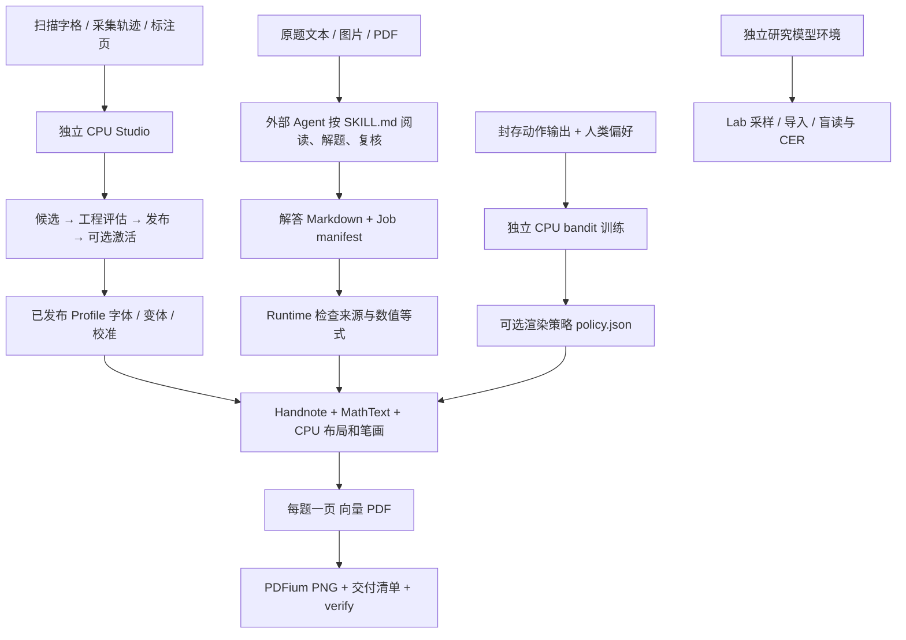

# 当前实现审计与开发交接画像

审计日期：2026-11-18。对象：本机 `/home/klmn/handwritten_solutions_skills` 的实际工作区，以及本地个人库和交付产物。最近发行版为 `v0.3.0`，HEAD 为 `e4e6349`；本报告描述的真实性升级大量存在于未提交源码中。**不能用发行包的版本号代替当前实现标识。**

本次读取了 CLI、Runtime、字体 Adapter、布局/笔画、Profile、Studio、RL 和实验采样的关键代码，核对训练与评估 JSON，重新运行双 Python 测试、真实五题重放和四模式探查。没有启动新训练、修改渲染逻辑、切换个人默认版本或重打正式发行包。上游信息以锁定依赖、已有源码审查记录及实际调用点为准；没有重新调查上游最新版本，也不构成完整的联网漏洞或法律审查。

## 1. 当前项目是什么

当前已经形成 **Agent 工作流说明 + 可独立运行的 CPU 手写排版器 + 版本化个人字体/校准库 + 小规模渲染策略偏好实验**。它能稳定交付可核验的一题一页 PDF，已经真正使用本人的扫描字形；但英文仍由单字轮廓拼成，公式仍按 MathText 的结构定位。没有训练出能够直接生成自然英文整行、完整数学书写轨迹或整页作业的神经模型。

| 指标 | 本机核对结果 |
|---|---|
| Git / 发行 | `main`，4 个提交，`v0.3.0 → e4e6349`，没有配置远端；审计开始时 22 个已跟踪文件修改，另有新增文件 |
| 当前代码规模 | `src` 39 个 Python 文件、5,047 行；测试 8 个文件、1,721 行；脚本 7 个文件、693 行。行数不代表质量 |
| 本人字形 | 75 个采集码点，178 个真实轮廓；61 个码点各 2 形，14 个各 4 形；字体总覆盖 517 码点，余下 442 个并非本人采集 |
| 本人布局数据 | 2 张自然书写图，分为 4 个区域；16 行英文、29 行数学、131 个词间距 |
| 本人数学线条 | 另取 1 张原验收页中的 2 条横线轮廓，供均值横线和公式横线使用 |
| 真实轨迹数据 | 本人导入记录中没有逐点时间、压感和笔顺；扫描照片不能恢复这些真实观测 |
| Profile 版本 | `personal@v1/v2/v3` 已本地发布；默认仍为 `personal@v1`；另保留早期同源 `personal-round1@v1` |
| RL | 54 页动作实验；代理奖励 800 次更新；收到 12 组本人偏好后再更新 800 次；没有神经网络权重训练 |
| 本轮自动检查 | Linux Python 3.12、3.13 各 93 passed；Ruff 检查及 54 个 Python 文件格式检查通过 |
| 最新交付 | `personal@v3` + `stroke-enhanced` + 首轮人类偏好策略 + 字号修正；5 页 PDF/PNG 本轮逐字节重放成功 |
| 真实性验收 | 尚未达成独立、可泛化的自然手写质量验收；用户的 12 组反馈中有 6 组 neither |

最新完整样张：[五题 PDF](../out/realism/rl-size-feedback/candidate/homework_solutions.pdf)。机器证据：[审计快照](evidence/audit-2026-11-18/snapshot.json)、[运行复核](evidence/audit-2026-11-18/runtime-checks.json)、[补充检查](evidence/audit-2026-11-18/additional-checks.json)。

## 2. 系统边界与模块关系



**Agent 解题与 CLI 排版是两个环节。** `hwsol render` 读取已有解答，不调用模型 API，不会仅凭题干生成新答案。`SKILL.md` 规定调用它之前由宿主 Agent 完成解题与检查。五题 mixed 示例使用仓库内已有 Markdown，是排版和验证样例；历史 Euler 示例有 Agent 解题演练记录，但没有内置自主求解服务、OCR 服务或题目正确率基准。

| 模块 / 入口 | 已实现能力 | 使用边界 |
|---|---|---|
| `cli.py`：doctor、read-page、render、verify | 环境诊断、PDF 原页转图、正式交付、独立核验 | doctor 不是所有能力的验收；read-page 不做 OCR |
| `jobs/schema.py`、`jobs/runtime.py` | 原题来源、独立问题 ID、解答、作者与验证记录；来源快照、输出清单、非覆盖交付 | 题目库存和推导内容由 Agent 提供；`not_checked/inconclusive` 可被记录并交付 |
| `jobs/checks.py` | 受限 Python AST 解析数值式，用 SymPy 有理数精确复算 | 只检查 manifest 声明的数值等式；不证明一般符号推导，也不验证题意理解 |
| `jobs/layout.py` | 每题一页、墨迹边界、有限压缩/重排重试；失败保留报告 | 超长题拒绝；不是任意长度都能无损塞入一页 |
| `jobs/paper.py` | 空白、横线、方格、点阵、图片、指定 PDF 背景页 | 自定义 PDF 背景会栅格化；带吸附的纸张限制自由布局 |
| `adapters/profile_renderer.py` | 公式绑定实际 Profile 文件；修复同进程切换字体缓存；数学变体适配 | 缺数学字形仍可显式回退 STIX；不支持任意 LaTeX |
| `jobs/handwriting.py` | 行级基线、词距、缩进、公式组位置；真实多字形选择和相关倾斜 | 文字最终仍逐字符；没有词内连笔生成或完整行生成 |
| `jobs/math_strokes.py` | 从本人扫描横线包络替换均值横线、分数等规则横线 | 不是笔顺重放；矩阵开放括号仍是几何画线 |
| `jobs/ink_policy.py` | 估计轮廓笔宽，偏好合适变体，减少重复，相关倾斜 | 笔宽是图形代理量；未模拟真实压力、笔速、落笔和抬笔 |
| `profiles/*` | 资产摘要、候选/发布快照、激活、回滚、导入导出、写锁 | “不可变”是应用层约定及摘要检查，不是只读文件系统或数字签名 |
| `training/*`、`hwsol profile` / `hwsol-studio` | 扫描/轨迹/字体导入、全历史合并、布局测量、评估发布 | 普通未标注图片/PDF 只归档；CFF 可独立使用，不能参与累积合并 |
| `lab/rl.py` | 6 类动作、盲评题包、代理/人类奖励、单步策略训练 | 不生成新字形；无神经奖励模型；不学习整页或笔画序列 |
| `lab/protocol.py`、`lab/sampling.py` | 三模型图像导入、转写 CER；两模型隔离采样入口 | 已测协议和失败处理；没有真实模型质量、显存、延迟实测 |

### 排版感目前来自哪里

正文使用 Handnote 的字体度量和逐字绘制，真实变体改善重复轮廓，但字母之间没有真实书写连接。MathText 先确定分数、上下标、算子和矩阵等结构，再替换/适配字形；这保住了结构，也保留了明显的数学排版习惯。当前没有一套可供学习的通用 LaTeX AST/符号关系图公开接口，结构保护主要依靠复用解析器、整体移动公式和前后几何记录。

布局已从独立字符噪声改为有界相关基线及个人行观测，但校准仍按行序循环选记录，未理解“起始式、等号承接行、结论行、单栏/双栏”等语义。整页密度只受行距、边距、行起点及内容长度影响，没有学习页面整体概率分布。用户要求的一题一页和五题短解答，本身也留下大量白纸。

统一粗度目前是“统一用笔规则”：取消答案装饰性加粗、标题放大、额外轮廓描边，保留字形本身的粗细差。不是所有笔画强制等宽。普通数学与正文采用同一 em，分子分母按正文尺度呈现，上下标仍保留层级；这不等于每个字母的实际墨迹高度相同。

最新五题逐字形报告：无外部数学字体回退；第 9 题 `Newton's` 的撇号 U+0027 继承基底；矩阵括号有 6 次几何绘制。这个结论只适用于这五题，不能推导为所有公式均由本人字迹覆盖。

## 3. 到底做过哪些训练

### 3.1 样本与版本账本

个人库是 `profiles/realism-studio/`。`personal` 下有 9 条样本记录：2 条 accepted 扫描记录（共 4 张字格），5 条 accepted 校准记录，2 条原图归档。所有记录的 `has_recorded_strokes` 都为 false。`personal-round1` 另有同源的 2 条扫描记录，不是新增作者或新增训练数据。

| 阶段 | 实际操作与数据 | 产物 / 验收解释 |
|---|---|---|
| 早期工程验证 | Patrick Hand 衍生合成字格/轨迹，含两轮和九轮历史累积测试 | 证明合并、回滚、迁移等机制；不能作为本人风格训练 |
| 替代布局实验 | GNHK 公开图中 7 行，5 行校准、2 行留出；独立 `reference-layout@v1` | 行起点误差约 14.39 → 9.95 个页宽百分点；仅替代样本的局部布局实验，没有混进本人 Profile |
| `personal-round1@v1` / `personal@v1` | `latin1/2.jpg`、`math1/2.jpg`，模板定位、轮廓提取、FontTools 合并、GSUB 变体 | 75 码点、178 轮廓；是 CPU 字体构建，不是梯度训练。两份命名快照共享原始四图 |
| `personal@v2` | 完整历史重建，加英文/数学自然书写两图的 4 个标注区域 | 字形不变；16+29 行及 131 词距参与布局。特定留出题行首误差由 18.3% 变为 52.5%，没有证明布局普遍改善 |
| `personal@v3` | 历史重建，再增加两条实测横线包络 | 原字形和 4 组布局保留；第 5 条校准记录只有横线，并非新增整页布局训练 |
| 统一粗度、公式字号修正 | 修改排版和轮廓适配代码 | 工程修正，没有新增样本或新 Profile |
| l / p / y / 0 尺寸修正 | 横向适配与高度解耦，异常高度限制在同字符主字形的 95%–105% | 工程阈值，不是从 12 组偏好学出的高度分布；最新图尚未获得独立人评 |

实际 `personal` 有 3 次构建、3 次 Studio 评估，另一个早期命名有 1 次构建、1 次评估。构建日志停留在 `candidate` 是历史事件状态；是否发布应查看 `profiles/*/versions/`，不能只看旧 run.json。

v3 横线来自原 `heldout-mean-variance.jpg`。作者明确授权“允许使用验收页的横线，以后另留验收页”，因此它现在是校准来源，不能继续宣称为独立留出页。v2 当时的留出结果仍是有效历史记录，但不能复用于 v3 的独立验收。

照片只产生静态轮廓和空间测量。数据合约能保存 glyph/word/line/math 轨迹、逐点 x/y、可选 time/pressure，分开的 strokes 表示抬笔；本人的这些实测轨迹尚未提供。`median_pressure` 目前只保存，没有驱动 Runtime 笔宽；`pen_lean` 可参与倾斜，但当前本人校准也没有该真实测量值。单独只有 traces、没有 lines 或 math_strokes 的 calibration JSON 当前会被拒绝，需要另补轨迹导入流程才能方便地采集纯词/行样本。

### 3.2 渲染策略 RL 的准确含义

训练对象是 **六种既定渲染策略的抽样概率**。每页选一个动作，动作内部依据笔宽、前后连续性及重复惩罚选择现有字形；不会学习一个新字体，也没有训练扩散模型或自动恢复笔顺。

代理奖励为 `0.55·exp(-2·ink_log_rmse) + 0.25·exp(-2·ink_step) + 0.20·variant_entropy`。初始 prior 为 0.25/0.15/0.15/0.15/0.15/0.15。更新使用带运行基线、KL 和熵约束的单步 REINFORCE / gradient bandit，在有限已测奖励表中重复抽样。

| 回合 | 数据与更新 | 实际结果 |
|---|---|---|
| `rl-round1` 准备 | 6 动作 × 3 种子 × 3 训练题 = 54 页；另留第 7、9 题；生成 12 组匿名对照 | 每页实际渲染，核对数学记录及 PDF/PNG；未把合成标签当作作者偏好 |
| `rl-proxy-v1` | 无人类标签，800 次离线更新 | 已有数据上的期望代理奖励 0.741366 → 0.746417；另题 2 种子的前后抽查恰好选中相同动作，均值 0.720201 未变 |
| `rl-human-v1` | 你的 12 组真实偏好，继承代理策略，再更新 800 次 | 5 组侧选、1 tie、6 neither；同一批评分的期望奖励 0.317030 → 0.486714，仅说明拟合这些评分 |
| `rl-size-feedback` | 在旧证据训练完成后修复尺寸，复用旧策略为起点 | 新图未继承旧图的验收结论；不是第二轮新图人评训练 |

800 steps 是重复使用小数据表的优化步数，不是 800 页新增手写数据，也不是 800 个独立人评。

| 策略动作 | 代理训练后概率 | 人类偏好训练后概率 |
|---|---:|---:|
| accepted-b（同版本旧行为） | 26.31% | 61.81% |
| balanced | 11.28% | 2.43% |
| varied | 17.18% | 0.52% |
| steady | 11.94% | 0.67% |
| relaxed | 10.40% | 0.78% |
| light-varied | 22.89% | 33.79% |

人类标签转换规则：胜方 1、败方 0、tie 各 0.5、neither 各 0；报告数学错误会拒绝训练。两次训练都不自动激活全局策略。当前两个较受偏好的动作合计约 95.59%；这种集中不等于自然书写随机性已经改善。

人类回合另题的代理奖励均值约 0.720201 → 0.753644，但仅覆盖 2 题 × 2 种子，而且评价仍是工程代理量。`human_naturalness: not_evaluated` 指缺少独立自然度验收，不能理解成没有用过人类训练标签。

历史记录：[字体首轮](../out/realism/personal-v1/首轮训练记录.md)、[布局第二轮](../out/realism/personal-v2/第二轮训练记录.md)、[横线校准](../out/realism/personal-v3/修正记录.md)、[RL 方法](RL_RENDERING.md)、[人类训练 JSON](../out/realism/rl-human-v1/training.json)、[最新尺寸修正](../out/realism/rl-size-feedback/修正记录.md)。

## 4. 开源项目与依赖：哪些真正进入了产品

下表的版本与许可来自锁定文件、已存上游审查、安装元数据和调用代码；不表示已经获得数据集、个人样本或模型权重的再分发授权。

| 项目 | 固定来源 / 版本 | 在当前工程的真实角色 |
|---|---|---|
| [Handnote](https://github.com/zh271/handnote) | `114919f183817643c795e47e851ea25b96e3c393`，MIT；包版本 2.0.0.dev0 | **生产核心**。模板与扫描转字体、GSUB、Markdown 解析、字形/数学度量和向量 PDF；本项目通过 Adapter 和继承扩展 |
| Matplotlib / MathText | 3.11.2，随锁定环境 | **生产核心**。数学结构、字体路径和轮廓；STIX/DejaVu 等组件有独立字体许可 |
| FontTools / Pillow / NumPy / OpenCV headless | 4.68.0 / 13.0.0 / 2.5.5 / 5.0.0.93 | 字体合并/度量、图像、数值计算、扫描测量和笔宽代理；沿用现有依赖，没有因 RL 引入 PyTorch |
| pypdf / pypdfium2 / SymPy | 7.1.0 / 5.15.2 / 1.14.0 | PDF 组合与结构、栅格化/像素核验、精确数值等式 |
| Pydantic / Typer | 2.14.3 / 0.29.1 | 数据合约与 CLI；`references/job.schema.json` 本轮与运行时生成 schema 完全一致 |
| Patrick Hand | Google Fonts `4aa2f9643b044d0fdc55687891e4611f1f32a698`，OFL-1.1 | **随包字体和个人字体基底**。未采集字符可能继续来自它；不是神经模型 |
| [MarkdownToHandwrite](https://github.com/lyc07/MarkdownToHandwrite) | `634cf07987a9c84c59f808e03f879c9d93485374` | **隔离兼容实验**。仅 render-probe 显式指定解释器可调用；不在正式作业路线；SDT 轨迹和形变关闭，多变体个人 Profile 被明确拒绝 |
| [One-DM](https://github.com/dailenson/One-DM) | `dde2205a70a2c70d1786503d198a795358c80ee4`，代码 MIT | **Lab Adapter**。本地批采样入口、图片导入和评分；本机没有真实推理/训练结果 |
| [DiffBrush](https://github.com/dailenson/DiffBrush) | `da9addc1140bdfec463b2d41a974a0a392f80798`，代码 MIT | **Lab Adapter**。同上，偏完整英文行；测试使用替身进程/合成输出验证协议 |
| [DiffusionPen](https://github.com/koninik/DiffusionPen) | `059e2f2bcb7372231038719e955597917c1a8783`，代码 MIT | **输出导入和盲评**。没有接通可通用调用个人样本的采样入口 |
| [handwriting-to-font](https://github.com/obsrvgmi/handwriting-to-font) / [draw-your-font](https://github.com/danilo-znamerovszkij/draw-your-font) | `27c048a3…` / `ef367bb2…` | **早期调研/独立实验**。后者合成测试有记录；不是当前个人字体构建后端 |
| [DiffInk](https://github.com/awei669/DiffInk) | 既有调研记录，未作为本项目锁定依赖 | **仅调研**。不在 lab.models 目录，没有 Adapter、权重、实际推理或训练 |
| [HMEG](https://github.com/AiArt-Gao/HMEG) | 既有 CVPR 2024 调研记录 | **仅调研**。符号关系图的思路未实现为本项目布局模型 |
| [My Text in Your Handwriting](https://discovery.ucl.ac.uk/id/eprint/10075697/) | 既有作者论文记录 | **方法参考**。没有直接调用其训练器或生成器 |
| GNHK | 既有公开样本和许可记录 | **独立替代布局测量**，不是字体后端、未混入个人版本 |

这意味着，当前最主要的复用关系是 **Handnote + Matplotlib + 本项目 CPU 扩展**。不能将“调研过 DiffInk/HMEG”写成“已经接入生成式手写模型”。

许可与分发边界：本项目代码 MIT，内附字体 OFL-1.1；MTH 的既有轨迹授权记录未清，兼容环境还涉及 PyMuPDF 的独立条款；draw-your-font 的 potrace 依赖也不是统一 MIT。研究代码 MIT 不覆盖 IAM/CASIA 数据和权重。本人样本及 Profile 当前标为 local-only。相关原始记录见 [LICENSES](LICENSES.md)、[Phase 0 来源](evidence/phase0/upstream-sources.json)、[Phase 4](PHASE4.md)。

## 5. 本次复核了什么，没有证明什么

| 检查 | 本轮结果与证据 |
|---|---|
| Python 3.12 全套 | 93 passed，33.79 s；[日志](evidence/audit-2026-11-18/tests-py312.log) / [JUnit](evidence/audit-2026-11-18/tests-py312.xml) |
| Python 3.13 全套 | 93 passed，33.25 s；[日志](evidence/audit-2026-11-18/tests-py313.log) / [JUnit](evidence/audit-2026-11-18/tests-py313.xml) |
| 检查范围 | jobs 31、profiles 16、realism 21、RL 5、phase0 12、lab 6、兼容 Adapter 2；两环境均启用隔离 MTH 用例，无跳过 |
| 静态检查 | Ruff check passed；54 个 Python 文件格式检查通过。见同目录 ruff 日志 |
| 最新真实交付 | 已有五题 `verify --pixels` 通过；当前源码另渲染五题，PDF + 5 张 PNG 与交付逐字节一致 |
| 四模式行为 | personal@v3、第 6 题、关闭策略，每种模式各渲染 1 页并像素核验；四模式都包含 3 处个人横线替换 |
| 旧训练证据保护 | 当前代码读取旧 rl-round1 题包时拒绝继续训练：`Renderer changed since this trial; prepare a new comparison` |
| schema | 仓库 JSON Schema 与当前 Pydantic Job schema 一致 |
| 旧发行文件 | 四份 v0.3.0 发行文件重新核对 SHA256SUMS 全通过；这不代表包含当前开发代码 |
| GPU 可用性 | 本次 nvidia-smi 返回码 9，无法联系驱动；历史文档的 GPU 识别记录不能替代当前可用性。项目 samples/profiles/checkpoints 中未找到神经权重文件 |

本轮新生成的核查样张位于 `out/audit-2026-11-18/`；没有覆盖历史图或评分。也抽看了最新第 6 题页图，公式仍集中在页上部，正文仍是逐字组合；此类观察不计作作者盲评。

验收需分成四层：

1. **交付一致性**：摘要、页序、数量、来源、尺寸及 PDF/PNG 相同。已有自动检查。
2. **声明的数值正确性**：仅检查给出的等式，不自动验证整段推导与题意。已有部分自动检查。
3. **字形可读性与数学辨识**：某个数字、运算符即使写得难认，也可能通过前两层；需要独立转写与碰撞检查。
4. **本人风格及整页自然度**：需要未参与调参的本人样本和独立盲评；当前不充分。

现有测试通过不能合并成“已经实现自然手写”，也不能把 `verify` 当作数字签名或防恶意重写证明。当前未重新构建/离线安装包含全部最新改动的新 wheel，未取得 macOS/Windows 原生结果，未做大规模误写率、长期性能或联网安全数据库审计。

## 6. 按优先级排列的审计发现

这里的“高优先级”指后续开发或对外声称质量之前应先处理；不等于当前五题无法运行。

### A1 · 高：发行物、源码和版本标识已经分离

HEAD 和现有发行物均停留在 e4e6349，而布局、个人横线、策略训练和尺寸修正仍在工作区。`pyproject.toml`、Profile build 和报告继续写 0.3.0，单看版本无法定位真实代码。新增源码也尚未进入 Git 历史。证据：审计 snapshot 的 Git 状态、源码摘要、`scripts/package_release.py` 从指定 tag 打包的实现。

后续处理：先整理并保存可复现的源码版本，再按新的版本号打包；在构建、Profile 和训练报告中加入 renderer/build 标识与 lockfile 摘要。正式发布前对新 wheel 做独立安装重放。不要把旧 bundle 当作包含本轮成果的备份。

### A2 · 高：当前四模式已经不是“原版与单项升级”的完整消融

`jobs/layout.py::render_one` 在所有模式中执行统一字号、取消描边和 `apply_math_strokes`。本轮四模式第 6 题均有 3 处个人横线替换，baseline/layout-enhanced 也有。baseline 仍可使用字体的真实 GSUB 变体，并不等于“无随机性”。这符合修正共用基础行为的实现，但会干扰把当前 baseline 直接称作原版的实验解释。

后续处理：明确区分“固定发行版基线”与“当前共同修正基线”，记录参与实验的独立因素；需要衡量个人横线时增设实验开关或独立对照。保留所有分支共同的数学正确性修复。历史四版报告中“与 e4e6349 字节相同”只适用于当时归档文件。

### A3 · 高：布局学习存在已知反例，尚无自然度泛化证据

v2 留出题中公式行首误差 18.3% → 52.5%。`handwriting.py::rhythm/plan` 将样本行序和剩余横向空间比例迁移到不同长度的公式；短式可能被推向页面中部。当前没有按等号列、推导组、单/双栏和内容角色建模。v3 仅新增横线，没有修复这项布局问题。

后续处理：先修正规划器的坐标表示，区分页边距/栏起点、公式起点和等号对齐锚；在短式/长式、单栏/双栏、承接行上分别验收。不能通过增加随机位移掩盖该缺陷。

### A4 · 高：人类偏好结果尚不能证明新版自然度提高

只有 12 组、一个作者、少量题目，且 6 组 neither。评分被转换为各动作的平均收益，没有显式建模题目差异、对手强弱或置信区间；800 次重复更新不会增加独立数据量。训练后又改变了字号适配，旧反馈没有覆盖新图。原手写留出页也已转用于横线校准。

后续处理：冻结修正版生成新的盲评；平衡动作、题目和种子；分开评价字形像本人、页布局自然、粗细与大小、数字/符号可读性。另留新的整页样本。合格前保持候选状态，避免自动切换默认版本。

### A5 · 中：策略对渲染器的绑定不完整

`lab/rl.py::_renderer_stamp` 对 7 个本项目文件做摘要检查，确实能阻止本次旧图继续训练；但未覆盖 `adapters/handnote.py` 等其他渲染来源、上游版本和 uv.lock。`RenderPolicy` 运行时只绑定 Profile 摘要，允许旧策略被新渲染器使用，尺寸修正版就是一次明确记录的实验性迁移。`training_sha256` 也未把 seed/steps 等超参数全部纳入；这些参数另在 training.json 中。

后续处理：增加完整 renderer fingerprint 与策略兼容版本，迁移需要显式标记；训练身份包括数据、标签、算法、超参数、依赖和源码。仍应允许可审查的迁移实验，但不能当成原策略已验证的新环境。

### A6 · 中：所谓笔画/词行训练的实际覆盖比数据合约窄

数据合约有多种轨迹类型，但当前训练只提取空间校准和少量斜率/压力统计；Runtime 不重放词/行轨迹，压力不驱动墨迹。当前横线包络只覆盖两类水平线，开放矩阵括号仍走几何路径。`render-probe` 也绕过正式作业的布局、fill-only 和个人横线等完成步骤；Studio 的早期 probe 预览不等同于生产页验收。

后续处理：在文档和报告区分“可保存数据”“用于特征校准”“用于实际生成”；普通任务统一验收正式 Runtime。若做词/行 Adapter，先增加可独立导入和留出的轨迹样本，再验证逐字符转写与公式组合，不应仅给已有字段换一个“训练完成”的名称。

### A7 · 中：文档和默认选择容易让使用者用错成果

个人库默认仍为 v1，v3 需要显式选择；未设置 HWSOL_DATA_DIR 时本机用户库没有默认设置，会使用 bundled-default。新 Job 缺省 realism=baseline，Skill 则推荐 combined；最新偏好交付实际是 stroke-enhanced。历史文档还混有 49/65/70/80/88/93 的测试数，以及“尚无本人样本”“均匀采样”等早期描述。

后续处理：以本报告作为当前状态入口；使用归档 manifest 重放最新结果；将历史文档标成阶段记录，避免用 `combined`、`personal` 或“最新”暗指一个固定组合。样本 weight 仍只影响字体首选顺序，和 RL 的非均匀选择是不同机制。

### A8 · 中：实验产物的发布生命周期仍不完整

`lab/rl.py::train` 在候选渲染和留出检查完成前就写出 policy.json；后续失败可能留下没有成功 training.json 的策略文件。普通 Profile 已有候选/评估/发布流程，策略没有同等完整的发布门槛。另外，Profile 的工程评估明确为 `manual_style_review: not_performed`，通过就可以本地发布，不能作为作者风格认证。

后续处理：策略也采用暂存、完整评估、原子完成标记及显式激活；报告分别显示工程合格、作者接受、独立自然度验证。此项是从代码流程识别的失败风险，本次没有故意破坏真实训练目录进行故障注入。

## 7. 开发阶段画像与建议顺序

仓库原有 Phase 0–4 是底座、作业交付与神经实验的工程路线；用户后来提出的真实性 P1–P4 是另一套验收维度，不能混为“Phase 4 已完成，所以自然手写已完成”。

| 范围 | 当前判断 | 完成前缺什么 |
|---|---|---|
| 原 Phase 0–2：底座、Profile、正式作业 | Linux 工程功能已具备 | 新改动的发行与长期维护；新题 Agent 效果仍由外部流程负责 |
| 原 Phase 3：验证与可移植 | Linux 实测成熟度较高 | 新 wheel 验收、macOS/Windows 原生 CI |
| 原 Phase 4：研究工具 | 适配/导入/评分基础设施具备 | 获授权资产、真实推理、准确率、风格、性能与部署验证 |
| 真实性 P1：渲染诊断 | 已完成主要路径诊断 | 持续记录新路径和模式语义变化 |
| 真实性 P2：CPU 增强 | 可运行、可重放，有实际用户修正 | 词内自然连接、稳定公式布局、完整盲读及自然度验收 |
| 真实性 P3：个人风格学习 | 已有真实字形及少量布局校准 | 独立整页数据、稳定布局特征、词/行轨迹用于生成 |
| 真实性 P4：可选神经模型 | 尚无实际模型实验 | 先证明 CPU 路线残余问题，再做一个模型的独立小规模验证 |

建议按以下里程碑推进，不重新开发整套系统：

| 顺序 | 工作 | 明确验收条件 |
|---|---|---|
| M1 | 固定当前源码与渲染器身份，清理文档入口和模式定义 | 同一 manifest/Profile/seed 能定位唯一实现；旧发行基线与当前基线明确区分；新包安装重放通过 |
| M2 | 修正公式组与等号续行布局；补足撇号等实际缺口；保留字号/统一用笔修复 | 既有反例改善；不同长度与栏结构无回归；原题、符号、分数结构保持正确 |
| M3 | 冻结 M2 结果，用新数据做平衡盲评与独立转写 | 在未参与训练的题目和本人页上分别报告三项风格指标及误写率；所有评测数字/运算符无未解决误读；胜率与不确定性一起报告 |
| M4 | 决定是否保留/扩展 CPU bandit；必要时试一个词/行 Adapter | 与固定无策略基线做比较；若风格、可读性无收益就停止增加更新步数 |
| M5 | 有证据后再验证 DiffInk 等候选模型 | 许可证和输入就绪；小规模真实推理、CER、风格、人审、延迟/内存明确；公式继续保留结构保护；通过后才讨论训练与生产接入 |

目前最值得投入的是 **版本可复现、公式布局反例、修正版独立验收**。没有证据支持直接扩大神经训练，或继续用同一批 12 组标签提高“训练奖励”来宣称手写质量提高。

## 8. 当前怎么用，以及下次训练怎样接续

### 重放当前最新个人成果

在本机项目目录中运行，输出目录每次换新名称：

```bash
cd /home/klmn/handwritten_solutions_skills
export HWSOL_DATA_DIR="$PWD/profiles/realism-studio"
.venv/bin/hwsol render \
  --manifest out/realism/rl-size-feedback/candidate/manifest.json \
  --output out/my-current-personal-job
.venv/bin/hwsol verify --job out/my-current-personal-job --pixels
```

这份 manifest 固定了 v3、种子、stroke-enhanced 和偏好策略，并引用同目录中的源题与解答；**不需要先激活 v3**。不要附加 `--realism combined` 后仍称为同一份重放。安装新环境使用源码 checkout 中的 `uv sync --locked --no-dev`；旧 v0.3.0 wheel 无法代表这组最新功能。

新题先交给已加载本项目 Skill 的 Agent，由它读取原题、解题、复核、写新 manifest 和解答，再调用 Runtime。CLI 没有新的 solve 命令。若手工准备 manifest，可以固定 `profile: personal@v3`；policy 必须匹配该 Profile 的摘要，切换 Profile 后不能直接沿用旧绑定。省略 policy 会关闭策略实验，不影响正常个人字体渲染。

### 继续字体/布局构建

原始字格与样本元数据、全部版本和训练记录都保存在个人库中；Runtime ZIP 足以渲染，**继续全历史训练应保留整个个人库**。

1. 新字符或更多真实变体：用 `hwsol profile template` 生成有配套 JSON 的字格，填写后通过 `profile import --template` 导入。不要拿普通自然页假装已配准字格。
2. 新布局：原图加逐行文字与区域标注，经 `profile measure-page` 产生 calibration JSON，再用 `profile import --kind calibration` 导入。自动 OCR/自动逐行标注尚未实现，当前由人工或 Agent 做标注并检查。
3. `profile train --profile personal --append` 会从全部 accepted 历史重建新候选；用返回的版本运行 `profile evaluate`，人工查看后再 `profile publish`。当前已有 v1–v3，后续编号以 CLI 返回值为准。发布默认不激活。
4. 评估应生成相同题目和纸张的对照、逐页像素核验、独立数学转写与本人风格评分。工程 evaluate 通过不足以替代此步骤。
5. 若继续 RL，需在**当前冻结渲染器**上运行新的 `lab rl prepare`，再收新评分并 `lab rl train`；不能在旧 rl-round1 图上追加评分后绕过源码变化保护。

### 下一轮数据建议（未要求现在上传）

以下是启动下一轮所建议的规模，不是“达到这个数量就足够训练神经模型”的保证。无需重写全部字格。

| 内容 | 建议数量与形式 | 未来存放位置 |
|---|---|---|
| 日常英文整页 | 2 页，各 8–15 行；正常速度，含自然连笔、标点和换行 | `samples/realism-inbox/round-3/train/english-01.jpg` 等 |
| 数学整页 | 3 页：短式/长式混排、等号连续推导、分数/上下标/矩阵各有实例；优先完整单栏，双栏另注明 | `samples/realism-inbox/round-3/train/math-01.jpg` 等 |
| 独立验收页 | 3 页新内容：1 英文、2 数学；不用于提取字形、横线或调参 | `samples/realism-inbox/round-3/holdout/` |
| 内容与拍摄说明 | UTF-8 `transcript.txt`，按页/行转写，说明纸张尺寸、单/双栏、使用的笔；原图保留四边，可 JPG/PNG/PDF，扫描约 300 DPI 为宜 | train、holdout 分别保存，避免混用标签 |
| 缺字补充 | 如需去掉当前撇号基底，或补足新题出现的符号：先生成对应字格，建议每字符 4–6 个真实样本；l/p/y/0 可视新图评价再决定是否补写 | `samples/realism-inbox/round-3/glyphs/`，连同模板 JSON |
| 可选平板轨迹 | 上述页面的原始文件或逐笔 JSON；有真实 x/y/time/pressure/pen-up 就保留，没有就留空 | `samples/realism-inbox/round-3/traces/`；先确认导出格式再转换 |

以后需要词/行生成时，可在这些页中标注重复出现的词和连笔；先验证 Adapter 能消费真实轨迹，再扩采，避免收集大量当前程序用不到的数据。新的盲评建议覆盖全部 15 种动作配对，并跨题目与种子平衡，必要时分批完成；独立验收的题目和样本应与训练评分分开。

## 9. 文件地图与交接约束

| 路径 | 内容与后续用途 |
|---|---|
| `src/hwsol/`、`tests/`、`uv.lock` | 当前未打包开发实现、回归测试、依赖锁 |
| `profiles/realism-studio/` | 真实个人库、完整历史、发布快照、默认指针；目前默认 personal@v1 |
| `samples/realism-inbox/` | 4 张字格、2 张布局页、原验收页、转写和 RL 反馈 |
| `out/realism/personal-v1/` | 第一轮字体、旧发行版与当时源码的四模式对照 |
| `out/realism/personal-v2/` | 布局标注、校准、反例测量和训练记录 |
| `out/realism/personal-v3/` | 本人横线提取、B 对照、可迁移 Profile ZIP |
| `out/realism/math-size/` | 公式与正文尺度修正的历史对照 |
| `out/realism/rl-round1/` | 54 页封存证据、匿名 12 组 PDF、私有动作映射 |
| `out/realism/rl-proxy-v1/`、`rl-human-v1/` | 两次策略文件、训练参数、奖励和候选；均对应尺寸修正前渲染器 |
| `out/realism/rl-size-feedback/` | 当前候选五题、字号对照、迁移与数学一致性记录；后续优先从这里继续 |
| `out/audit-2026-11-18/` | 本轮只读审计派生的重放与模式探查产物 |
| `docs/evidence/audit-2026-11-18/` | 当前代码摘要、Git 状态、训练摘要、测试与运行复核记录 |
| `dist/v0.3.0/` | 原始正式发行文件，四份摘要仍通过；不包含后续真实性升级 |
| `task_plan.md`、`notes.md` | 本机任务过程记录；与 samples/profiles/out 一样被 .gitignore 排除，不是 Git 备份 |

交接时保留原始输入、版本快照、策略、反馈和渲染来源；不覆盖旧图、不把旧评分继承为新图评分，不把已用于校准的页面重新命名成 holdout。当前最新 PDF 的成功重放证明的是工程一致性，后续是否更像本人仍交由新数据和独立评价决定。
