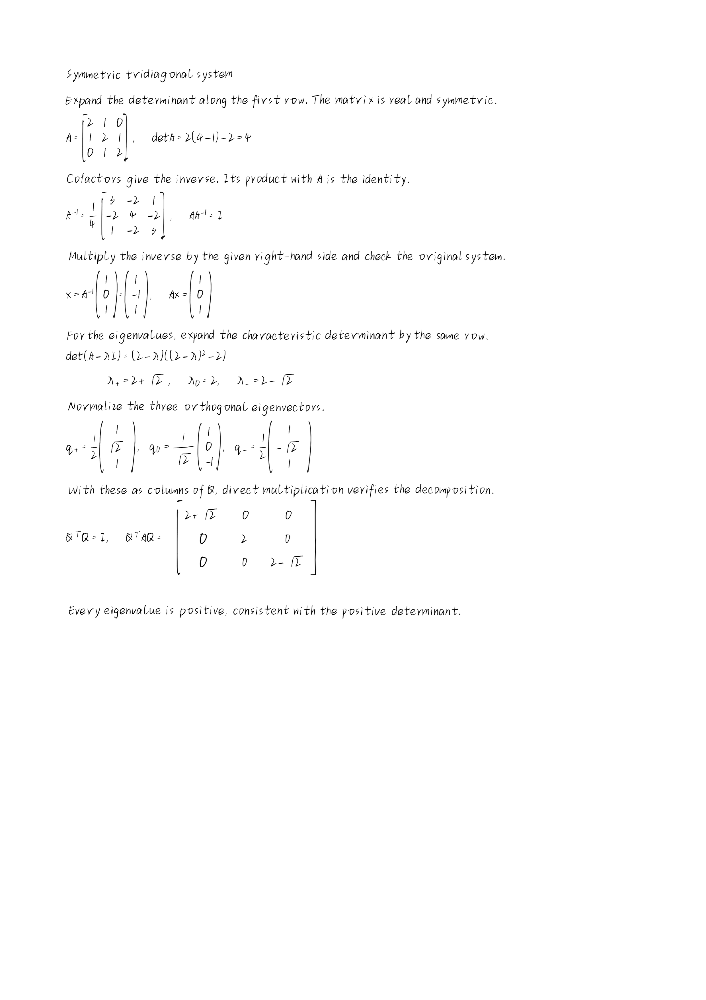
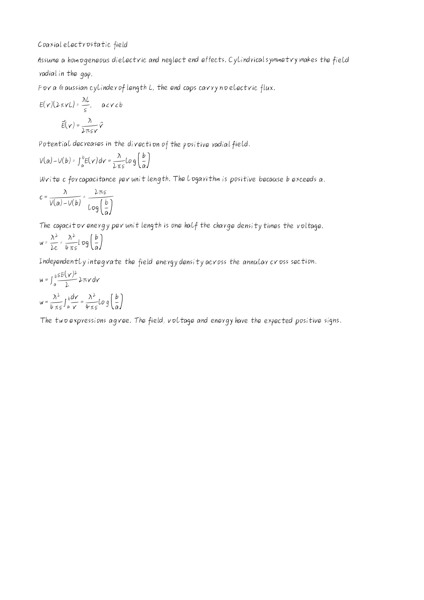

# 真实个人笔迹演示

这份四页作业使用作者已审核的个人笔迹 Profile，通过普通 CPU 出稿入口实际生成。
作者已明确授权公开这些成品页面。PDF 与 PNG 均保持验收产物的原始字节，没有重新描画、
补笔、裁剪或美化。

[完整四页 PDF](homework_solutions.pdf) · [逐项汇总与文件校验](provenance.json)

| 线性代数：矩阵、方程组与谱分解 | 物理：同轴电容器与场能 |
| --- | --- |
|  |  |

PDF 的其余两页为定积分和正态总体均值推断。题目为 Agent 编写的受控数学示例，
不包含姓名、学校标识或私人作业原文。

本例采用个人字体轮廓、已核验的数学原迹和结构笔画规则，由 Handnote / MathText 保证
公式结构与排版。它是 **个人 CPU 渲染**，不是神经网络新生成的笔迹，也不是直接展示原始扫描。
当前 Profile 使用已认可的 `1.1448` 词距倍率。

四页共记录 827 个数学可见项目，无外部字体回退；其中 47 项为基于个人原迹的结构规则，
6 项为程序结构几何。这些类别仍明确记录，不能把“零字体回退”解释为每个笔画都直接复制自
个人字形，或任意数学公式都已覆盖。完整逐项来源与原始资产保留在本地。

**公开的是演示成品，不是个人字体或 Profile。** 作者的原始作业、字体文件、字形裁剪和
模型权重不随本演示分发，因此公开安装包不会自动生成与这里完全相同的个人笔迹。
需要立即复现公开输入时，请使用[默认字体示例](../demo/README.md)；它使用随包提供的
Patrick Hand 字体，与本页展示的个人笔迹分开说明。
